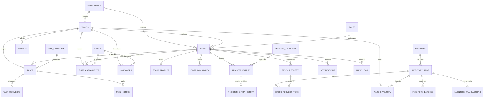

# NurseFlow — Relational Database Schema & Data Dictionary
## Final Year Engineering Technical Documentation

---

### 1. Entity-Relationship Diagram (Mermaid)

---

### 2. Core Relational Tables & Data Dictionary

#### 1. `departments`
- `id` (TEXT, PK): Unique identifier (`dept-icu`, `dept-genmed`, etc.)
- `code` (TEXT, UNIQUE): Short clinical code (`ICU`, `GENMED`, `SURG`)
- `name` (TEXT): Full clinical department title
- `description` (TEXT): Operational scope

#### 2. `wards`
- `id` (TEXT, PK): Primary key (`ward-micu`, `ward-fsw`, etc.)
- `department_id` (TEXT, FK -> `departments.id`): Associated parent department
- `name` (TEXT): Clinical ward label (`Medical ICU (MICU)`)
- `code` (TEXT, UNIQUE): Ward station code (`MICU-01`)
- `floor` (TEXT): Physical architectural floor
- `bed_capacity` (INTEGER): Maximum inpatient occupancy (e.g. 16, 28)

#### 3. `roles`
- `id` (TEXT, PK): Role key (`role-nurse`, `role-supervisor`, `role-inventory`, `role-admin`)
- `name` (TEXT, UNIQUE): Clinical role designation
- `description` (TEXT): System and ward permissions

#### 4. `users`
- `id` (TEXT, PK): UUID
- `employee_id` (TEXT, UNIQUE): Official hospital staff identifier (`NF-NUR-101`)
- `name` (TEXT): Full legal name
- `email` (TEXT, UNIQUE): Domain login address
- `password_hash` (TEXT): Salted bcrypt password hash (rounds = 10)
- `role_id` (TEXT, FK -> `roles.id`): Authorization persona
- `department_id` (TEXT, FK -> `departments.id`): Stationed department
- `ward_id` (TEXT, FK -> `wards.id`, NULLABLE): Stationed primary ward
- `phone` (TEXT): Official hospital extension / contact number
- `status` (TEXT): `ACTIVE`, `INACTIVE`, `SUSPENDED`
- `last_login` (DATETIME): Timestamp of most recent authentication

#### 5. `patients`
- `id` (TEXT, PK): Unique patient identifier
- `uhid` (TEXT, UNIQUE): Universal Hospital Identification Number (`UHID-2026-1001`)
- `name` (TEXT): Synthetic anonymized patient name
- `age` (INTEGER): Age in years
- `gender` (TEXT): `Male`, `Female`, `Other`
- `ward_id` (TEXT, FK -> `wards.id`): Current admitting ward
- `bed_number` (TEXT): Bed assignment (`Bed 4`)
- `admission_date` (TEXT): Admission calendar date (`YYYY-MM-DD`)
- `diagnosis` (TEXT): Attending diagnosis
- `attending_doctor` (TEXT): Physician in charge
- `status` (TEXT): `ADMITTED`, `DISCHARGED`, `TRANSFERRED`

#### 6. `tasks`
- `id` (TEXT, PK): Primary key
- `title` (TEXT): Task instruction summary
- `description` (TEXT): Clinical context and details
- `category_id` (TEXT, FK -> `task_categories.id`): Category classification
- `ward_id` (TEXT, FK -> `wards.id`): Location of execution
- `assigned_to` (TEXT, FK -> `users.id`): Operating nurse
- `created_by` (TEXT, FK -> `users.id`): Assigning nurse supervisor
- `priority` (TEXT): `Low`, `Medium`, `High`, `Urgent`
- `status` (TEXT): `Pending`, `In Progress`, `Completed`, `Cancelled`
- `due_date` (TEXT): ISO 8601 clinical execution deadline
- `patient_reference` (TEXT): Patient Bed & UHID link
- `instructions` (TEXT): Aseptic clinical instructions
- `completion_notes` (TEXT): Sign-off documentation
- `completed_at` (DATETIME): Sign-off legal timestamp
- `completed_by` (TEXT, FK -> `users.id`): Nurse who signed off
- `escalated` (INTEGER): `0` or `1`
- `escalated_reason` (TEXT): Clinical escalation justification

#### 7. `register_entries` & `register_entry_history`
- Non-destructive clinical record storage:
  - `register_entries`: Holds current active version of register entry (`current_version`, `data_json`, `status`).
  - `register_entry_history`: Holds immutable snapshots of previous versions with `version`, `user_id`, `data_json`, and mandatory `reason` for correction.

#### 8. `inventory_items` & `inventory_batches`
- `inventory_items`: Universal catalog (code, name, category, unit, min_stock, cost_per_unit).
- `inventory_batches`: Lot-level tracking (batch_number, item_id, quantity, initial_quantity, expiry_date, location_bin, status).

#### 9. `inventory_transactions`
- Forensic ledger of every physical supply movement:
  - `type`: `RECEIVED`, `ISSUED`, `RETURNED`, `ADJUSTED`
  - `quantity`: Number of units transferred
  - `source` / `destination`: Routes
  - `user_id`: Performed by staff member

#### 10. `handovers`
- Structured ISBAR shift handover transitions:
  - `ward_id`, `shift_id`, `date`, `outgoing_nurse_id`, `incoming_nurse_id`
  - `status`: `DRAFT`, `PENDING_ACKNOWLEDGEMENT`, `ACKNOWLEDGED`, `INCOMPLETE`
  - `notes`, `equipment_issues`, `unresolved_incidents`, `pending_task_ids`
  - `acknowledged_at`: Legal incoming nurse digital sign-off timestamp

#### 11. `audit_logs`
- Tamper-evident operational audit trail:
  - `user_id`, `action`, `entity`, `record_id`, `details`, `ip_address`, `created_at`

---

### 3. Database Indexes for High Concurrency

| Index Name | Target Table | Indexed Columns | Rationale |
| :--- | :--- | :--- | :--- |
| `idx_tasks_ward` | `tasks` | `ward_id` | Fast ward-filtered task queries |
| `idx_tasks_assigned` | `tasks` | `assigned_to` | High performance personal shift task lookups |
| `idx_tasks_status` | `tasks` | `status` | Rapid filtering of pending vs completed tasks |
| `idx_tasks_due` | `tasks` | `due_date` | Instant calculation of overdue care tasks |
| `idx_register_entries_ward_code` | `register_entries` | `ward_id, register_code` | Quick retrieval of specific register records per ward |
| `idx_inventory_batches_expiry` | `inventory_batches` | `expiry_date` | Real-time near-expiry (&lt;60d) and expired alerts |
| `idx_stock_requests_status` | `stock_requests` | `status` | Instant filtering of pending requisitions |
| `idx_notifications_user_unread` | `notifications` | `user_id, is_read` | Sub-millisecond unread badge count lookups |
| `idx_shift_assignments_date_ward` | `shift_assignments` | `date, ward_id` | Fast daily ward duty roster generation |
| `idx_audit_logs_user` | `audit_logs` | `user_id` | Forensic user audit trail inspections |
| `idx_patients_ward` | `patients` | `ward_id` | Fast inpatient bed occupancy count |
