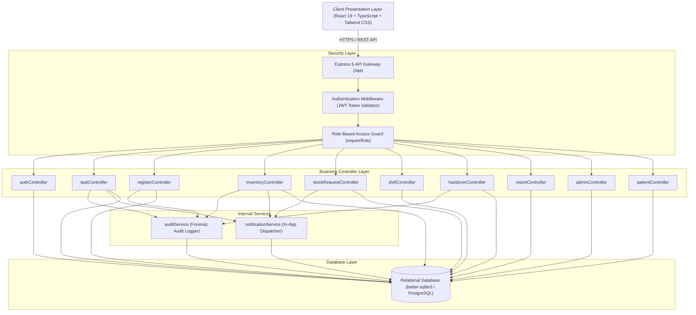
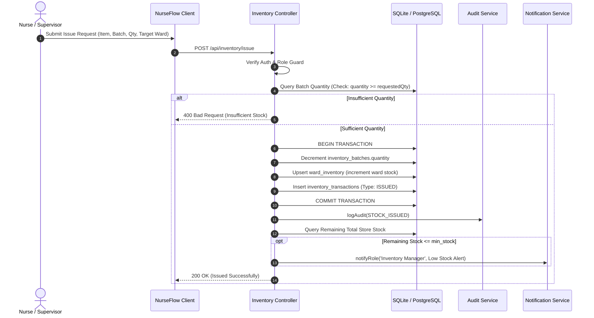
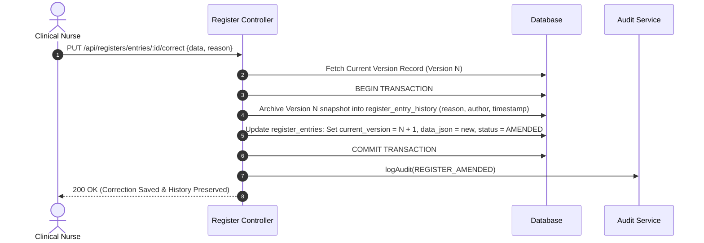

# NurseFlow — System Architecture & Design Specification
## Final Year Engineering Technical Documentation

---

### 1. Architectural Overview

NurseFlow is engineered as an enterprise-grade hospital clinical operations and nursing workflow management system. It follows a multi-tier client-server architecture with strict separation of concerns among:
- **Presentation Layer (Frontend Single Page Application)**
- **API & Authorization Middleware Layer**
- **Business Logic & Service Layer**
- **Relational Persistence Layer (SQLite / PostgreSQL)**

---

### 2. Client-Side Architecture

The client is built using **React 19**, **TypeScript**, and **Tailwind CSS**, bundled via **Vite**.
- **State Management**: React Context providers (`AuthContext`, `ToastContext`) provide reactive state without external boilerplate.
- **Route Guards**: Protected route wrappers ensure unauthenticated requests redirect to `/login`, and unauthorized role attempts render a clinical `403 Unauthorized` view.
- **Component Architecture**: Reusable atomic components (`Button`, `Badge`, `Modal`, `Drawer`, `LoadingSkeleton`, `PageHeader`, `EmptyState`) enforce UI consistency.
- **API Communication**: The typed `api` client (`client/src/services/api.ts`) encapsulates token injection, HTTP request dispatching, and uniform error normalization.

---

### 3. Server-Side Architecture

The backend is built using **Node.js** with **Express 5** and **TypeScript (`tsx`)**:
- **Stateless Authentication**: High-entropy JWT tokens carrying user identifier, employee ID, and assigned clinical role.
- **Role-Based Access Control (RBAC)**: Declarative `requireRole(['Nurse', 'Head Nurse / Supervisor', 'Inventory Manager', 'Administrator'])` guards enforce access server-side.
- **Atomic Concurrency Protection**: High-value inventory issues and stock reconciliations execute inside atomic database transactions (`db.transaction(...)`).

---

### 4. Core Clinical Data Flows

#### Flow 1: Ward Stock Consignment Issue

#### Flow 2: Non-Destructive Digital Register Correction (NABH / JCI Guideline)

---

### 5. Future Engineering Scope
1. **Barcode / QR & RFID Scanning**: Hardware scanner integration via WebHID / WebUSB API for bedside medication verification (Five Rights).
2. **HL7 / FHIR Gateway**: Integration with hospital electronic health record (EHR) and laboratory information systems (LIS).
3. **Predictive Consumption Forecasting**: Time-series ARIMA / LSTM models predicting seasonal antibiotic and IV fluid replenishment.
